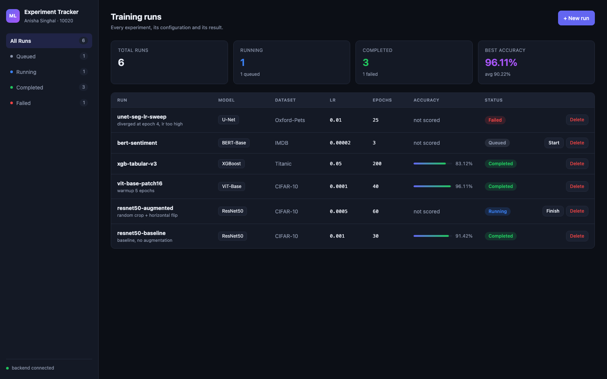
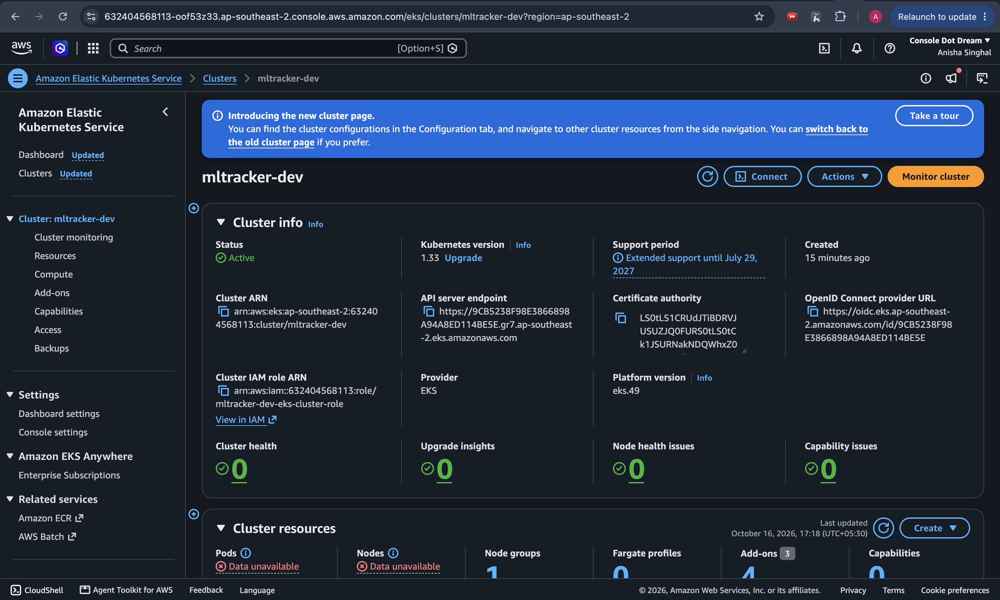
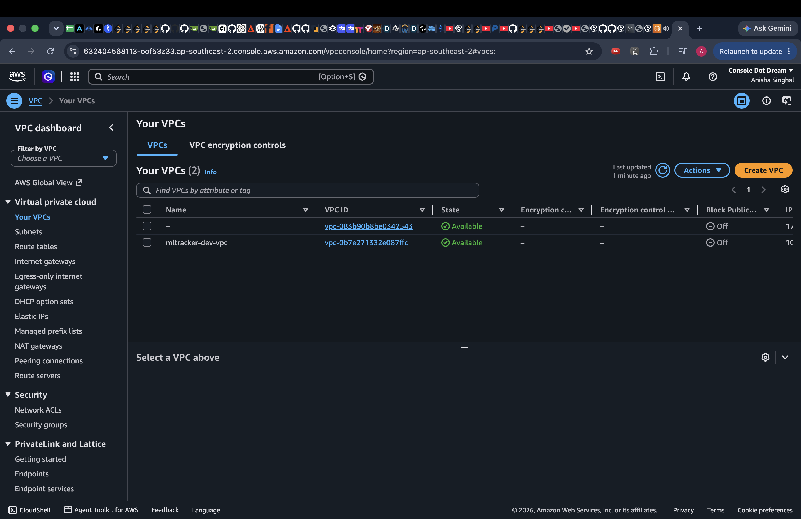
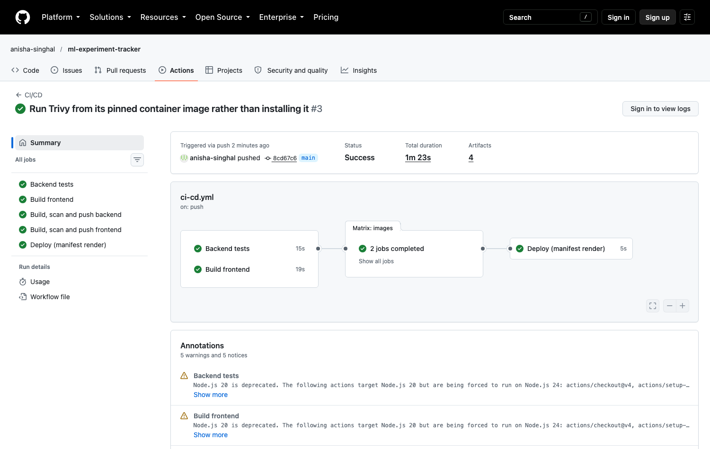
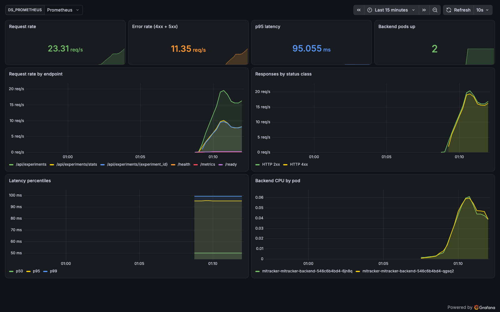

# ML Experiment Tracker

**Anisha Singhal** · Enrollment **10020** · DevOps Final Capstone Project

A web application for tracking machine-learning training runs — what was trained, on
what data, with what hyperparameters, and how well it scored — taken the whole way from a
laptop to a monitored Kubernetes cluster.



## What it does

Anyone who has run more than a handful of experiments has lost track of which configuration
produced the good number. This records each run as a row: name, model type, dataset, learning
rate, epochs, status and accuracy.

- Create a run, move it `queued → running → completed`, record its accuracy, delete it.
- Filter by status, see aggregate statistics — total, counts per status, best and average
  accuracy.
- Accuracy is deliberately **nullable**: a queued run has no score yet, which is a different
  thing from having scored 0.0. That distinction runs through the schema, the API and the UI.

The application is a vehicle for the DevOps work, but it is a real application: 9 endpoints,
a migrated relational schema, validation at the edge, and a UI that works at phone width.

## Architecture

```
  Developer
      │ git push
      ▼
  GitHub ──────► GitHub Actions
                   │
                   ├─ pytest (17 tests)          ─┐
                   ├─ frontend build              │ both must pass
                   │                              │
                   ├─ docker build (matrix) ◄─────┘
                   ├─ trivy scan            ── image is scanned BEFORE it is pushed
                   ├─ security gate         ── fails on fixable HIGH/CRITICAL
                   ├─ push to GHCR          ── tagged with the commit SHA
                   └─ helm lint + template
                              │
                              ▼
                       Argo CD  ── reconciles helm/mltracker from this repo
                              │        drift is reverted, not just reported
                              ▼
                      Kubernetes (kind / EKS)
                              │
                  ┌───────────┴────────────┐
                  │     Ingress (nginx)    │
                  │   /  → frontend        │
                  │   /api → backend       │
                  └───────────┬────────────┘
                     ┌────────┴────────┐
                     ▼                 ▼
              frontend × 2        backend × 2 ──► PostgreSQL
              nginx + React       FastAPI          StatefulSet + PVC
                                      │
                                      │ /metrics
                                      ▼
                            Prometheus ──► Grafana

  Terraform ──► AWS VPC (2 AZ, public + private) ──► EKS + managed node group
```

## Technologies

| Layer | Used |
|---|---|
| Frontend | React 18, Vite 5, plain CSS |
| Backend | FastAPI, SQLAlchemy 2, Pydantic v2, Alembic |
| Database | PostgreSQL 16 |
| Tests | pytest (17 tests, SQLite-isolated) |
| Containers | Docker, multi-stage builds, non-root runtimes |
| CI/CD | GitHub Actions, GitHub Container Registry |
| Security | Trivy image scanning with a build-failing gate |
| Orchestration | Kubernetes, Helm 3, ingress-nginx |
| GitOps | Argo CD — declarative sync from this repository |
| Infrastructure | Terraform — AWS VPC + EKS |
| Observability | Prometheus, Grafana, prometheus-fastapi-instrumentator |

## Repository layout

```
.
├── backend/           FastAPI app, Alembic migrations, pytest suite, Dockerfile
├── frontend/          React dashboard, nginx config, multi-stage Dockerfile
├── helm/mltracker/    Helm chart: deployments, services, ingress, HPA, StatefulSet
├── argocd/            Argo CD Application - the deployment, as a file
├── k8s/               namespace, kind cluster definition
├── demo/              presentation deck and recording script
├── terraform/         AWS VPC + EKS
├── monitoring/        Prometheus values, Grafana dashboard as a ConfigMap
├── scripts/           test runner, load generator
├── docs/              screenshots and captured command output
├── .github/workflows/ CI/CD pipeline
└── docker-compose.yml
```

---

## Running it

### Docker Compose — the whole stack in one command

```bash
docker compose up --build
```

Then open **http://localhost:3000**.

Four services come up in order: PostgreSQL, a one-shot Alembic migration, the backend, the
frontend. The backend waits on `service_completed_successfully` for the migration rather than
plain `depends_on`, which would only wait for the container to *start* and would race the
schema into existence.

If something else on your machine already holds port 3000:

```bash
FRONTEND_PORT=3001 docker compose up --build
```

### Tests

```bash
./scripts/run-tests.sh      # runs pytest in a container, exactly as CI does
```

```
17 passed in 0.10s
```

Tests never touch PostgreSQL. The `get_db` dependency is overridden to hand out sessions bound
to a throwaway SQLite database, using `StaticPool` so every session shares one connection and
can see the tables the fixture created.

### Kubernetes

```bash
kind create cluster --config k8s/kind-cluster.yaml
kubectl apply -f https://raw.githubusercontent.com/kubernetes/ingress-nginx/controller-v1.11.3/deploy/static/provider/kind/deploy.yaml
kubectl wait --namespace ingress-nginx --for=condition=ready pod \
  --selector=app.kubernetes.io/component=controller --timeout=300s

docker build -t mltracker-backend:dev ./backend
docker build -t mltracker-frontend:dev ./frontend
kind load docker-image mltracker-backend:dev mltracker-frontend:dev --name mltracker

kubectl apply -f k8s/namespace.yaml
helm upgrade --install mltracker ./helm/mltracker \
  -n ml-tracker -f helm/mltracker/values-dev.yaml --wait
```

Then open **http://localhost:8080** — the kind cluster maps host 8080 to the ingress.

```
$ kubectl get pods -n ml-tracker
NAME                                            READY   STATUS    RESTARTS   AGE
mltracker-mltracker-backend-548b4fcd-f5z28      1/1     Running   0          17s
mltracker-mltracker-backend-548b4fcd-jl5ch      1/1     Running   0          33s
mltracker-mltracker-frontend-667986ddbd-mm86c   1/1     Running   0          33s
mltracker-mltracker-frontend-667986ddbd-x2mgs   1/1     Running   0          21s
mltracker-mltracker-postgres-0                  1/1     Running   0          19m
```

Full output in [`docs/kubectl-output.txt`](docs/kubectl-output.txt).

### Monitoring

```bash
helm repo add prometheus-community https://prometheus-community.github.io/helm-charts
helm upgrade --install prometheus prometheus-community/kube-prometheus-stack \
  -n monitoring --create-namespace -f monitoring/prometheus-values.yaml --wait

kubectl apply -f monitoring/grafana-dashboard.yaml
helm upgrade --install mltracker ./helm/mltracker -n ml-tracker \
  -f helm/mltracker/values-dev.yaml --set serviceMonitor.enabled=true

./scripts/load-test.sh http://localhost:8080 120          # give it something to show
kubectl port-forward -n monitoring svc/prometheus-grafana 3300:80
```

Grafana at http://localhost:3300 (`admin` / `admin`), dashboard **ML Experiment Tracker —
Application**.

### Infrastructure

Terraform provisions the AWS side: a VPC across two Availability Zones with public and private
subnets, an Internet Gateway, a NAT Gateway, and an EKS cluster with a managed node group.

```bash
export AWS_PROFILE=your-profile
terraform -chdir=terraform init
terraform -chdir=terraform plan  -out=tfplan
terraform -chdir=terraform apply tfplan
aws eks update-kubeconfig --region ap-southeast-2 --name mltracker-dev
kubectl get nodes
terraform -chdir=terraform destroy
```

**This was applied to a real AWS account, verified, and destroyed.** 33 resources planned; the
EKS 1.33 control plane went `ACTIVE`, both `t3.medium` workers registered `Ready`, and
`kubectl get nodes` answered from the EKS API server. `terraform destroy` then removed 30
resources, and an independent sweep with the AWS CLI found nothing left that bills. Total
runtime was under an hour, a fraction of a dollar of credits.

| | |
|---|---|
| Region | `ap-southeast-2` (Sydney) |
| VPC | `10.0.0.0/16`, 2 public + 2 private subnets across 2 AZs |
| EKS | `mltracker-dev`, Kubernetes 1.33, Active |
| Node group | `mltracker-dev-nodes`, 2 × t3.medium, both Ready |

The EKS cluster in the AWS console:



The VPC it runs in:



The full transcript — plan, state, CLI verification of every resource, `kubectl get nodes`, the
destroy and the sweep — is in [`docs/terraform-output.txt`](docs/terraform-output.txt).

Two account-specific findings shaped the run, both covered under *Things that broke*: the
account is pinned to `ap-southeast-2`, and its policy also refuses
`iam:CreateOpenIDConnectProvider`, so the IRSA provider and the EBS CSI add-on that depends on
it were the only resources that did not come up. Neither is part of the cluster or the network.

The same configuration also runs for free against LocalStack (`-var-file=localstack.tfvars`),
which is how it was developed before any real resource existed; LocalStack's free edition does
not implement EKS, so that path creates the VPC only.

---

## CI/CD

[`.github/workflows/ci-cd.yml`](.github/workflows/ci-cd.yml) runs on every push to `main`.

```
   test              build-frontend
  (pytest)           (npm run build)
      └────────┬───────────┘
               ▼
          images  [matrix: backend, frontend]
          build → trivy scan → security gate → push to GHCR
               │
               ▼
            deploy
      helm lint + helm template
```

Three decisions worth pointing at:

- **The image is built with `load: true` and scanned before any push.** Pushing first would
  mean a vulnerable image is already public by the time the gate runs.
- **Tags are the commit SHA, never `:latest`.** A deployment then names exactly one immutable
  build, and a rollback is a different SHA rather than a hope that `:latest` has not moved.
- **`test` and `build-frontend` are a fan-in.** Both must pass before anything is built, so a
  failing test can never produce a published image.

Published images (public, anyone can pull):

```bash
docker pull ghcr.io/anisha-singhal/ml-experiment-tracker-backend:<commit-sha>
docker pull ghcr.io/anisha-singhal/ml-experiment-tracker-frontend:<commit-sha>
```



### Live demo — change, pipeline, deployment

The loop that shows the whole thing working end to end:

```bash
# 1. make a visible change
vim frontend/src/main.jsx
git commit -am "Rename the dashboard heading"
git push

# 2. watch the pipeline
gh run watch

# 3. take the SHA it published and roll the cluster onto it
SHA=$(git rev-parse HEAD)
helm upgrade --install mltracker ./helm/mltracker -n ml-tracker \
  --set backend.image.repository=ghcr.io/anisha-singhal/ml-experiment-tracker-backend \
  --set backend.image.tag=$SHA \
  --set frontend.image.repository=ghcr.io/anisha-singhal/ml-experiment-tracker-frontend \
  --set frontend.image.tag=$SHA \
  --wait

kubectl get pods -n ml-tracker -w     # old pods terminate, new ones come up
```

Refreshing http://localhost:8080 shows the change.

The `deploy` job renders and lints the manifests rather than applying them,
because a GitHub-hosted runner has no route to a cluster on this laptop. On EKS
the same step becomes a `helm upgrade` once the runner can authenticate with
`aws eks update-kubeconfig` — the chart and the image tags are already exactly
what it would use.

## Deployment — GitOps with Argo CD

The chart was originally installed by running `helm upgrade --install` in a
terminal. That works, but the cluster's desired state then lives in whoever last
ran the command and the flags they happened to pass. Argo CD moves that state
into this repository:

```bash
kubectl create namespace argocd
kubectl apply -n argocd -f https://raw.githubusercontent.com/argoproj/argo-cd/v2.13.1/manifests/install.yaml
kubectl wait --for=condition=available --timeout=420s deployment --all -n argocd

kubectl apply -f argocd/application.yaml
```

That last line is the whole deployment. Argo CD clones this repository, renders
`helm/mltracker` with `values.yaml` plus
[`values-gitops.yaml`](helm/mltracker/values-gitops.yaml), and reconciles the
cluster against it.


Three things are worth pulling out, and the reasoning is in
[`argocd/README.md`](argocd/README.md):

**Image tags are pinned to a full commit SHA, not `:main`.** With a moving tag, a
pod restart weeks later silently pulls something different from what its
neighbours are running, and nothing in Git records the change. Pinned, the
deployed version is a value in the repository — changing it is a commit, and
`git log` becomes a deployment history.

**Drift is corrected rather than reported.** `selfHeal: true` means a hand edit
to the live cluster is reverted. [`docs/argocd-output.txt`](docs/argocd-output.txt)
captures it: the frontend Deployment is scaled from 2 to 1 with `kubectl scale`,
and is back at 2 within five seconds.

**The backend's replica count is exempt from that.** The HPA owns
`/spec/replicas` at runtime, so the live value legitimately differs from what the
chart renders. Without an `ignoreDifferences` rule the application sits
permanently `OutOfSync` and `selfHeal` fights the autoscaler — each writing its
own number back, indefinitely. Git owns the Deployment; the HPA owns that one
field.

## DevSecOps — what Trivy found

Trivy scans both images for known CVEs in OS packages and language dependencies. The gate is:

```bash
trivy image --severity HIGH,CRITICAL --ignore-unfixed --exit-code 1 <image>
```

**The first scan failed both images, which is the gate working rather than a problem with it.**

The backend had **3 fixable HIGH** CVEs, all in `starlette 0.41.3`. Take
**CVE-2026-48818**: Starlette's `StaticFiles` did not reject Windows UNC paths, so a crafted
request path could make the server open `\\attacker\share\...` — server-side request forgery,
and on Windows a leak of NTLM credentials to a host the attacker controls. Nothing in this
repository imports `StaticFiles`, but the vulnerable code shipped inside the image, and
"we do not call that function today" is not a security control.

The interesting part is that `starlette` is not a direct dependency — `fastapi` pins it. The
fix was upgrading `fastapi 0.115.5 → 0.143.0`, which pulls `starlette 1.7.0`. All 17 tests
pass unchanged on the new stack.

The frontend was worse: **41 fixable findings**, 2 CRITICAL, none of them this project's code.
All of them came from `nginx-unprivileged:1.27-alpine` — libssl, libexpat, libpng, libxml2,
musl, zlib. A pinned base tag is rebuilt far less often than Alpine ships fixes, so the image
carried months of already-released patches. Moving to `1.29-alpine` and running
`apk upgrade --no-cache` at build time took it to zero.

```
BEFORE   backend   3 fixable HIGH            frontend  41 fixable (2 CRITICAL, 39 HIGH)
AFTER    backend   0                          frontend  0
```

One honest caveat: the backend still reports **44 HIGH with no fix available**. `--ignore-unfixed`
excludes those deliberately — failing a build on a CVE that nobody has patched yet blocks every
build for a reason this repository cannot act on. They are tracked, not hidden; the full
severity breakdown is in [`docs/trivy-output.txt`](docs/trivy-output.txt).

## Observability

The backend exposes Prometheus metrics at `/metrics` via
`prometheus-fastapi-instrumentator`. A `ServiceMonitor` tells the Prometheus Operator to scrape
both backend pods; the Grafana dashboard is a ConfigMap labelled `grafana_dashboard: "1"`, so it
is version-controlled rather than clicked together in the UI and lost on the next reinstall.



Eight panels: request rate, error rate, p95 latency, backend pods up, request rate by endpoint,
responses by status class, latency percentiles (p50/p95/p99) and per-pod CPU.

`scripts/load-test.sh` deliberately mixes 404s and 422s into its traffic, because a dashboard
that only ever shows 200s proves nothing about its error-rate panels.

## Evidence

Every screenshot the grading rubric asks for, by module. Terminal captures are rendered from
real command output, and each one's title bar says where that output came from — a named
GitHub Actions run, or the local terminal.

| Module | What | Where |
|---|---|---|
| M1 | App running in the browser | [`app-dashboard.png`](docs/screenshots/app-dashboard.png), [`app-new-run.png`](docs/screenshots/app-new-run.png) |
| M1 | Responsive layout at 430px | [`app-responsive-mobile.png`](docs/screenshots/app-responsive-mobile.png) |
| M2 | `pytest -v`, 17 passed, from CI | [`pytest-output.png`](docs/screenshots/pytest-output.png) · [`docs/pytest-output.txt`](docs/pytest-output.txt) |
| M3 | Commit history, 30+ commits | [`git-commit-history.png`](docs/screenshots/git-commit-history.png) |
| M4 | `docker compose up --build` | [`docker-compose-up.png`](docs/screenshots/docker-compose-up.png) |
| M4 | The app at `localhost:3000` from Compose | [`compose-app-localhost-3000.png`](docs/screenshots/compose-app-localhost-3000.png) |
| M5 | Green CI/CD pipeline | [`github-actions-pipeline.png`](docs/screenshots/github-actions-pipeline.png) |
| M5 | GHCR images tagged by commit SHA | [`ghcr-package.png`](docs/screenshots/ghcr-package.png) |
| M6 | Trivy gate output from a pipeline run | [`trivy-pipeline-output.png`](docs/screenshots/trivy-pipeline-output.png) · [`docs/trivy-output.txt`](docs/trivy-output.txt) |
| M7 | EKS cluster in the AWS console | [`aws-eks-cluster.png`](docs/screenshots/aws-eks-cluster.png), [`aws-eks-clusters-list.png`](docs/screenshots/aws-eks-clusters-list.png) |
| M7 | VPC in the AWS console | [`aws-vpc.png`](docs/screenshots/aws-vpc.png) |
| M7 | Plan, apply, verify, destroy, sweep | [`docs/terraform-output.txt`](docs/terraform-output.txt) |
| M8 | `kubectl get pods`, `svc`, `ingress` | [`kubectl-pods-svc-ingress.png`](docs/screenshots/kubectl-pods-svc-ingress.png) · [`docs/kubectl-output.txt`](docs/kubectl-output.txt) |
| M8 | `helm upgrade --install` and `helm list` | [`helm-install-and-list.png`](docs/screenshots/helm-install-and-list.png) |
| M8 | App through the Ingress | [`k8s-app-via-ingress.png`](docs/screenshots/k8s-app-via-ingress.png) |
| M8 | Argo CD `Synced` / `Healthy`, self-heal | [`argocd-application-tree.png`](docs/screenshots/argocd-application-tree.png) · [`docs/argocd-output.txt`](docs/argocd-output.txt) |
| M9 | `/metrics` output | [`metrics-endpoint.png`](docs/screenshots/metrics-endpoint.png) · [`docs/metrics-output.txt`](docs/metrics-output.txt) |
| M9 | Prometheus targets `UP` | [`prometheus-targets.png`](docs/screenshots/prometheus-targets.png) |
| M9 | Grafana dashboard | [`grafana-dashboard.png`](docs/screenshots/grafana-dashboard.png) |
| M10 | Slide deck | [`demo/slides.pdf`](demo/slides.pdf) |

## Things that broke, and why

Kept because the debugging is the part worth reading.

- **The Helm `pre-install` hook could never work.** The migration Job was a `pre-install` hook,
  and `helm install` timed out every time. A `pre-install` hook runs before *every* chart
  resource — including the PostgreSQL StatefulSet — so it had nothing to connect to. Moved into
  an initContainer on the backend Deployment, where ordering is guaranteed per pod.

- **`display: flex` on a `<td>` breaks table layout.** The action buttons rendered outside the
  panel's rounded border. A table cell with `display: flex` leaves the table formatting context.
  Fixed by moving the flex to an inner `<div>`.

- **Mobile overflow was not the CSS I suspected.** The page scrolled sideways at phone width, and
  I "fixed" it twice without checking. Measuring in a real browser showed
  `document.documentElement.scrollWidth === 430`, exactly the viewport — the page was already
  correct and my screenshot tool was rendering at the wrong size. The real fix was still needed:
  grid children default to `min-width: auto`, so the wide table sets a floor on its column unless
  `min-width: 0` lets it shrink and scroll internally.

- **Three POSTs returned 404 for no apparent reason.** They were sent during an ingress-nginx
  config reload, right after the Ingress host changed. Twenty consecutive requests afterwards
  returned 200. A transient reload race, not a bug — worth recognising before chasing it.

- **`psycopg2-binary` has no wheel for Python 3.9**, which is what macOS ships. Rather than
  installing a second system Python, the test suite runs in a `python:3.12-slim` container — which
  has the side benefit of matching CI exactly.

- **"EKS is blocked in this account" was actually "this region is not yours".** Every AWS
  call returned `explicit deny in a service control policy` — not only EKS, but S3, Lambda,
  DynamoDB, RDS and CloudFormation too. A policy denying *every* service looks like an account
  that cannot use AWS at all, and I spent a long time treating it as one, including a wrong
  guess that the account belonged to an employer.

  It was none of that. The account is enrolled in AWS's "projects" experience, which pins it
  to a single region — here `ap-southeast-2` — and denies anything addressed elsewhere. Every
  call had been made against `ap-south-1`, chosen because Mumbai is nearest. The denial message
  names the *service* and never the *region*, so the one fact that would have resolved it in
  thirty seconds is the one fact it omits.

  What finally showed it was opening the EC2 console in a browser: it loaded, and said
  *"Region Asia Pacific (Mumbai) unavailable — your project is assigned to Asia Pacific
  (Sydney)."* The console knew all along. The lesson is to read an `AccessDenied` as "something
  about this request is disallowed", not "this service is disallowed" — the request includes
  the region, the principal and the resource, and the message rarely says which one failed.

- **A Helm release named `mltracker` was deleted two seconds after it installed.** Installing
  the chart directly with `helm upgrade --install`, next to the Argo CD deployment, failed with
  `services "mltracker-mltracker-backend" not found` and pods already `Terminating`. Argo CD
  tracks the resources it owns by the `app.kubernetes.io/instance` label, and a Helm release
  stamps that label with the release name — so a release called `mltracker` produced resources
  Argo CD took to be part of *its* application, absent from Git, and pruned on sight. A release
  named `mltracker-helm` installs cleanly. The general point: two deployers sharing one tracking
  label will fight, and the faster one wins.

## Presentation

[`demo/`](demo/) holds the material the capstone is presented with:

| | |
|---|---|
| [`demo/slides.pdf`](demo/slides.pdf) | 11-slide deck — overview, architecture, tech stack, CI/CD, DevSecOps, infrastructure, Kubernetes and GitOps, observability, learnings. Source: [`demo/slides-src/slides.html`](demo/slides-src/slides.html) |
| [`demo/VIDEO-SCRIPT.md`](demo/VIDEO-SCRIPT.md) | The recording script: setup commands, tab order, and what to say in each of the nine parts |

## Known issues and limitations

Stated plainly, because a grader will find them anyway.

- **CI does not write the image tag back into Git.** `values-gitops.yaml` is
  updated by hand and pushed. The repository remains the source of truth, so
  this is still GitOps, but delivery is not fully automated — closing the loop
  needs a pipeline job that commits the new SHA, or Argo CD Image Updater.

- **The `deploy` job lints rather than deploys.** A GitHub-hosted runner has no
  route to the local kind cluster, and the EKS cluster was created for the evaluation and then
  destroyed rather than left running at $0.10 an hour, so the job renders and lints the chart.

- **No IRSA on EKS.** The AWS account's policy refuses `iam:CreateOpenIDConnectProvider`, so
  pod-level IAM roles and the EBS CSI driver that relies on them could not be provisioned. The
  cluster, node group and network were unaffected.

- **The HPA is disabled on kind.** kind ships no metrics-server, so an HPA there
  sits at `<unknown>/60%` forever. It is enabled in
  [`values-prod.yaml`](helm/mltracker/values-prod.yaml), and the scaling
  behaviour was verified separately with metrics-server installed —
  [`docs/metrics-output.txt`](docs/metrics-output.txt).

- **The PostgreSQL password is a chart default.** `postgres.password` in
  `values.yaml` is a development convenience. A real deployment sets
  `postgres.existingSecret` and the value never enters the repository.

- **Argo CD runs in insecure mode locally.** Its default is an HTTPS redirect
  with a self-signed certificate, which means a browser warning on every visit.
  A real cluster terminates TLS at the Ingress with a real certificate.

- **44 HIGH CVEs with no available fix remain in the backend image.**
  `--ignore-unfixed` excludes them deliberately; see the DevSecOps section.

## Mapping to the grading rubric

| Module | Where |
|---|---|
| M1 Application | [`backend/app/`](backend/app/), [`frontend/src/`](frontend/src/), [`backend/alembic/versions/`](backend/alembic/versions/) |
| M2 Testing | [`backend/tests/`](backend/tests/), [`backend/pytest.ini`](backend/pytest.ini), [`docs/pytest-output.txt`](docs/pytest-output.txt) |
| M3 Git | this repository, 17+ commits, [`.gitignore`](.gitignore) |
| M4 Docker | [`backend/Dockerfile`](backend/Dockerfile), [`frontend/Dockerfile`](frontend/Dockerfile), [`docker-compose.yml`](docker-compose.yml) |
| M5 CI/CD | [`.github/workflows/ci-cd.yml`](.github/workflows/ci-cd.yml) |
| M6 DevSecOps | Trivy gate in the workflow, [`docs/trivy-output.txt`](docs/trivy-output.txt) |
| M7 Terraform | [`terraform/`](terraform/), [`docs/terraform-output.txt`](docs/terraform-output.txt) |
| M8 Kubernetes + Helm | [`k8s/`](k8s/), [`helm/mltracker/`](helm/mltracker/), [`docs/kubectl-output.txt`](docs/kubectl-output.txt) |
| M9 Observability | [`monitoring/`](monitoring/), Grafana and Prometheus screenshots |
| M10 Documentation + presentation | this file, [`demo/slides.pdf`](demo/slides.pdf), [`demo/VIDEO-SCRIPT.md`](demo/VIDEO-SCRIPT.md) |
| GitOps delivery | [`argocd/`](argocd/), [`docs/argocd-output.txt`](docs/argocd-output.txt) |
