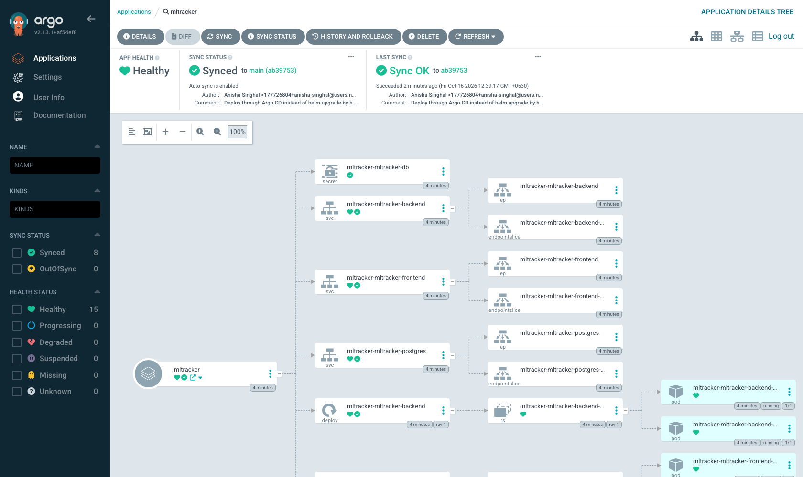

# GitOps with Argo CD

The chart in [`helm/mltracker/`](../helm/mltracker/) used to be installed with
`helm upgrade --install` from a terminal. That works, but it means the cluster's
desired state lives in whoever last ran the command and what flags they happened
to pass. Argo CD moves that state into this repository.

## What is here

| File | |
|---|---|
| [`application.yaml`](application.yaml) | The Argo CD `Application` — what to deploy, from where, into which namespace |
| [`../helm/mltracker/values-gitops.yaml`](../helm/mltracker/values-gitops.yaml) | The deployment record: pinned image SHAs and the kind ingress host |

## Installing

```bash
kubectl create namespace argocd
kubectl apply -n argocd -f https://raw.githubusercontent.com/argoproj/argo-cd/v2.13.1/manifests/install.yaml
kubectl wait --for=condition=available --timeout=420s deployment --all -n argocd

kubectl apply -f argocd/application.yaml
```

That is the whole deployment. Argo CD clones this repository, renders
`helm/mltracker` with `values.yaml` plus `values-gitops.yaml`, and applies the
result into `ml-tracker`.

Reaching the UI:

```bash
kubectl port-forward -n argocd svc/argocd-server 8081:80
kubectl -n argocd get secret argocd-initial-admin-secret -o jsonpath='{.data.password}' | base64 -d
```

Then `http://127.0.0.1:8081`, user `admin`.

> The port-forward above assumes `server.insecure=true` in
> `argocd-cmd-params-cm`. Argo CD's default is to redirect HTTP to HTTPS with a
> self-signed certificate, which means a browser warning on every visit. In a
> real cluster you would terminate TLS at the Ingress with a real certificate
> instead; insecure mode is a local-cluster convenience, not a recommendation.



## Why the Application looks the way it does

**Images are pinned to a full commit SHA, not `:main`.**
`values-gitops.yaml` names the exact digest-bearing tag CI published. With a
moving tag, a pod restart six weeks from now silently pulls something different
from what its neighbours are running — and nothing in Git records that it
changed. Pinning makes the deployed version a value in the repository, so
changing it is a commit and `git log` is a deployment history.

**`selfHeal: true`.**
Without it Argo CD reports drift and waits to be told. With it, a hand edit to
the live cluster is reverted. [`docs/argocd-output.txt`](../docs/argocd-output.txt)
captures that happening: the frontend Deployment is scaled from 2 to 1 by hand
and is back at 2 within five seconds.

**`ignoreDifferences` on the backend Deployment's `/spec/replicas`.**
This one is not optional. The HPA owns that field at runtime, so the live value
legitimately differs from what the chart renders. Without the exemption the
application sits permanently `OutOfSync` and `selfHeal` fights the autoscaler —
Argo CD writing the chart's replica count back while the HPA writes its own,
indefinitely. The rule says: Git owns the Deployment, the HPA owns that one
field.

**`PruneLast=true`.**
The PostgreSQL StatefulSet owns its PVCs through `volumeClaimTemplates`, so the
claims are not chart-rendered resources. Pruning aggressively on an ordinary
sync risks taking the database with it.

**A `resources-finalizer` on the Application.**
Deleting the Application should delete what it created. Without the finalizer
the workloads are orphaned — still running, no longer managed by anything.

## What this does not do

CI does not write the new image SHA into `values-gitops.yaml` automatically.
That last step — a pipeline job that commits the tag back, or an Argo CD Image
Updater watching the registry — is the piece that would close the loop fully.
Here the tag is updated by hand and pushed, which is still GitOps (the
repository remains the source of truth) but is not fully automated delivery.
Worth being clear about rather than implying the loop is closed.
